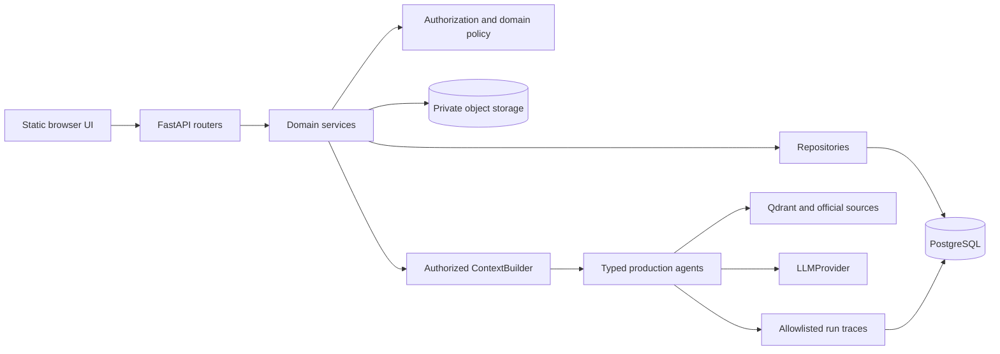

# System Architecture

## Architectural style

RegBridge is a modular monolith. One FastAPI process owns HTTP routing and application composition, while domain packages retain their own services, repositories, models, contracts, and policies. PostgreSQL is the transactional source of truth.

Do not split a feature into a new microservice or create one service per AI agent. Reuse the existing module and dependency direction.



## Application composition

`app/main.py` is deliberately thin. `create_app(settings)`:

- configures logging;
- optionally warms regulatory retrieval;
- adds request-correlation middleware;
- disables stale static caching in development/local/demo;
- includes domain routers;
- mounts `frontend/` at `/` after API routes are registered.

Keep business logic out of `main.py` and route handlers. A typical request path is:

```text
router -> dependency/authentication -> service -> policy/authorization
       -> repository/integration -> typed response contract
```

## Layer responsibilities

### Routers

- Translate HTTP input into typed contracts.
- Resolve authentication/dependencies.
- Call one or more application services.
- Map known domain failures to safe HTTP responses.
- Never contain SQL, provider-specific prompt logic, or broad authorization shortcuts.

### Services

- Implement use cases and transaction boundaries.
- Enforce state transitions and call object-level authorization.
- Coordinate repositories, storage, workers, agents, and audit records.
- Return typed domain/application results rather than ORM objects.

### Repositories

- Own persistence queries.
- Apply tenant/project/resource scoping supplied by an authorized caller.
- Avoid embedding UI behavior or AI prompting.
- Never treat a UUID lookup as proof of access.

### Contracts

- Pydantic models define API and AI boundaries.
- Responses expose explicitly selected fields.
- AI context and trace projections are allowlist-based and minimized.

### Models and migrations

- SQLAlchemy models represent current runtime persistence.
- Alembic migrations are the only supported schema-change mechanism.
- Approved table and column names come from the database source-of-truth document.

## Infrastructure boundaries

| System | Responsibility | Never use it for |
| --- | --- | --- |
| PostgreSQL | Users, authorization, metadata, facts, snapshots, runs, workflow state | Raw uploaded file bodies |
| MinIO/S3-compatible storage | Private immutable document objects | Authorization decisions or public URLs by default |
| ClamAV | Uploaded-file malware scanning | Content extraction or semantic verification |
| Keycloak/OIDC provider | Authentication and token issuance | RegBridge business-role authority |
| Qdrant | Regulatory evidence chunks and similarity retrieval | Project authorization or project knowledge graph truth |
| LLM providers | Bounded generation/semantic assistance | Authoritative scores, permissions, snapshots, or unverifiable facts |

## Approved modules

The approved modules are:

- `identity`
- `projects`
- `documents`
- `regulatory`
- `compliance`
- `investment`
- `research`
- `ai`

Related capabilities such as events, matching, contact requests, sharing, briefs, and opportunities are implemented within the approved product architecture. Do not invent a ninth top-level domain without an explicit architecture decision.

## Cross-module dependency rules

- Identity establishes the current user; application roles come from the database.
- Projects own project membership and project facts.
- Documents reuse project authorization and reference exact project/document versions.
- AI obtains data through repositories and ContextBuilder, never raw sessions or ORM entities.
- Regulatory assessment and roadmap consume authorized, versioned project context.
- Investment and research access shared resources only through explicit visibility/grant rules.
- Audit records accompany sensitive permission and document state changes.

## Request correlation and agent hierarchy

Every agent execution has its own `agent_runs.id`. A shared `request_id` correlates one root request and its children; it is not unique per run. `parent_run_id` records execution hierarchy. Child runs retain the root correlation ID even when some sibling runs fail.

## Configuration

`app/core/config.py` uses Pydantic Settings and reads a local `.env` file using UTF-8, case-insensitive names, and ignored unknown values. Important categories include:

- database and environment;
- OIDC issuer/audience/discovery/algorithms;
- object storage and ClamAV;
- document upload and extraction limits;
- Qdrant and embedding configuration;
- Mistral, Gemini, DeepSeek, and Ollama provider configuration;
- trace and Copilot diagnostic limits;
- official-source and external-processing feature flags.

Secrets are represented using `SecretStr`. Never print `model_dump()` of settings without explicit exclusion/redaction.

## Key architecture decisions

- [ADR-0006: lightweight production orchestration](../docs/adr/0006-lightweight-orchestration.md)
- [ADR-0007: derived project knowledge graph](../docs/adr/0007-derived-project-knowledge-graph.md)
- [Architecture/product decisions](../docs/decisions/RegBridge_Decisions_et_tracabilite_v2.0.md)

Production orchestration is explicit Python/Pydantic. LangGraph may appear in research dependencies but is not a production dependency.
