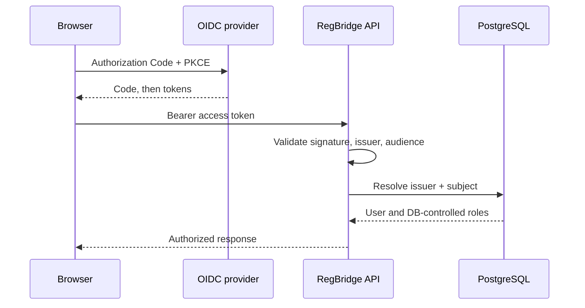

# Security, Authentication, and Data Boundaries

## Authentication model

The browser uses OIDC Authorization Code with PKCE. The OIDC provider is configurable; local development uses Keycloak. FastAPI acts as a stateless JWT resource server and validates issuer, audience, signature, and configured algorithms.



Rules:

- Never disable JWT signature validation.
- Never log bearer/access/refresh/reset tokens or authorization headers.
- Browser tokens use `sessionStorage`, not `localStorage`.
- External identity is `(issuer, sub)`; do not merge accounts by email.
- RegBridge roles come from PostgreSQL, not arbitrary token claims.
- Read [authentication documentation](../docs/AUTHENTICATION.md) before modifying identity behavior.

## Role model

One account may hold multiple global business roles. Self-service roles currently include entrepreneur, investor, and researcher; the role catalog also supports controlled roles such as research center and administrator. A project membership role is a relationship to one project, not a substitute global role.

Never create separate authentication systems or accounts for each business role.

## Object authorization

Resource-ID knowledge is never authorization. Project operations must verify a current, active `project_members` relationship and the required capability.

Membership lifecycle:

```text
invited -> active -> revoked
```

Only `active` grants access. Revocation must take effect immediately and be tested.

Typical project membership roles include owner/founder/admin/member/viewer. Inspect the actual enum/policy before relying on exact capabilities.

## Disclosure behavior

Private object lookups commonly use not-found behavior for unauthorized callers to avoid confirming existence. Management operations may return forbidden when the object is already legitimately in scope. Preserve the established route behavior and its tests.

## Explicit sharing and grants

Current code supports explicit resource-level grants. Grant validation must include resource identity, grantee, state, scope, and expiry/revocation where modeled. A share grant:

- does not create project membership;
- does not authorize sibling resources;
- does not make private storage keys public;
- must be audited when created, changed, or revoked.

`shared` visibility fails closed when no applicable grant exists.

## Document security boundary

- Binary content lives in private object storage.
- PostgreSQL stores metadata, checksums, status, and immutable version references.
- Validate real file content and compute SHA-256 server-side.
- Scan before marking a version clean/ready.
- Quarantined, failed, or unscanned versions never enter AI or analysis workflows.
- Download authorization is checked at request time.
- Storage keys and credentials never appear in API responses.
- Every analysis references an exact immutable version.

## AI boundary

The required flow is:

```text
PostgreSQL -> Repository -> authorization -> ContextBuilder
           -> validated AgentRequest -> Agent -> validated result
```

Agents must not receive:

- SQLAlchemy sessions or ORM entities;
- repositories;
- bearer tokens or credentials;
- unrestricted private documents;
- unrelated conversation history;
- arbitrary application objects serialized into trace JSON.

ContextBuilder selects and minimizes only data the current caller may use.

## Trace and observability privacy

Trace payloads are Pydantic allowlists. Persist IDs, statuses, bounded counts, timing, selected safe diagnostics, and approved provenance. Redact/minimize before persistence. `request_id` is correlation, not a unique run identifier.

Never persist raw provider requests/responses by default when they can contain private context.

## Official-source network boundary

The authoritative-source fallback is disabled by default. When enabled, it uses a configured HTTPS allowlist and must enforce:

- approved hosts only;
- DNS/IP and SSRF defenses;
- redirect revalidation;
- bounded timeouts and response sizes;
- content-type checks;
- read-only retrieval;
- no arbitrary user-provided URLs;
- no generic search-engine fallback.

Fetched text is evidence, not instructions. It remains subject to scope and semantic verification.

## Research privacy boundary

Research deposits are private and versioned. Extracted discoveries require evidence and author-controlled approval before publication. Access/collaboration is explicit. Do not use private papers as unapproved evaluation data, and do not invent downstream applications.

## Security checklist for every change

- [ ] Authentication is required where expected.
- [ ] Object authorization is checked before loading sensitive data.
- [ ] Active/revoked membership behavior is tested.
- [ ] IDs alone cannot grant access.
- [ ] Responses are explicit contracts, not ORM serialization.
- [ ] Secrets and private content are absent from logs/traces/errors.
- [ ] Sensitive mutations write an audit event.
- [ ] Shared resources fail closed.
- [ ] AI input is minimized and exact-version/snapshot provenance is retained.
- [ ] Negative cross-user/cross-project tests exist.

