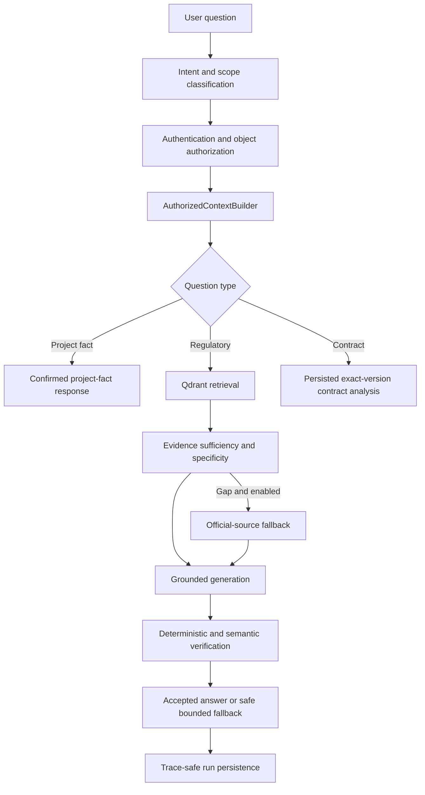

# AI, Copilot, and Retrieval

## Production principle

AI is advisory and bounded. Deterministic data, permissions, snapshots, evidence links, scores, and state transitions remain authoritative. The selected production orchestrator is lightweight explicit Python/Pydantic, not an agent framework.

Production code must not import `experiments` or LangGraph.

## End-to-end Copilot flow

General project questions such as sector or business model must not be forced through regulatory retrieval. They should use confirmed authorized project context and clearly state when the required fact is absent.

## Conversation and run model

- `conversation_threads` holds authenticated thread ownership/context.
- `conversation_messages` stores user-visible conversation messages.
- `agent_runs.id` identifies one execution.
- `request_id` correlates the root request and child runs.
- `parent_run_id` records hierarchy.

One child failure must not erase successful sibling results or provenance.

## ContextBuilder

ContextBuilder is the trust boundary between application data and agents. It must:

1. authenticate the caller;
2. authorize the requested project/resource;
3. load through repositories;
4. select confirmed/approved/exact-version records;
5. minimize fields;
6. construct a validated Pydantic request.

Never pass an ORM object, SQLAlchemy session, token, storage client, or repository into an agent.

## LLM provider abstraction

Production uses the existing `LLMProvider` protocol. Implementations include Mistral, Gemini, DeepSeek, and Ollama integrations. Provider selection and model names are configuration, not hard-coded route decisions.

A provider adapter owns:

- request formatting;
- authentication headers without logging secrets;
- bounded timeout and safe error mapping;
- structured-output normalization where supported;
- token/latency metadata where available.

Callers own domain validation and fallback behavior. A provider response is never trusted merely because JSON parsing succeeded.

## Regulatory retrieval

Regulatory chunks live in Qdrant and use BGE-M3 embeddings. Retrieval returns candidate evidence; it does not determine applicability by itself.

The evidence pipeline tracks:

- resolved question scope;
- required regulatory domains;
- domain coverage;
- specificity/scope support;
- `SUFFICIENT`, `PARTIAL`, or `INSUFFICIENT` status;
- provenance and source organization;
- fallback attempts and accepted evidence.

Generic domain mentions must not satisfy project-, classification-, or sector-specific questions. For example, a generic AI Act description does not prove the classification of the current system.

## Domain-targeted and official-source fallback

When local evidence is insufficient, domain-targeted Qdrant fallback may refine retrieval. If a genuine gap remains and the feature flag is enabled, the official-source adapter may fetch only configured official domains.

The official-source fallback must remain:

- disabled by default outside controlled/supportable use;
- HTTPS-only and allowlisted;
- bounded and SSRF-safe;
- read-only;
- revalidated after redirects;
- transparent in provenance.

It does not add generic web search.

## Verification and fallback

Generated claims are accepted only when they remain supported by the authorized context/evidence and do not contradict deterministic fields. On rejection, use a deterministic bounded response or declare the evidence gap.

Validators should detect at least:

- score/dimension/reason-code contradictions;
- invented criteria or unsupported claims;
- `UNKNOWN` represented as known;
- prompt-injection following;
- financial/legal prediction or advice overreach;
- lost source/snapshot/version provenance.

## Contract Agent

The Contract Agent reads authorized persisted analysis for an exact clean document version. It does not silently rerun a provider, alter the original file, or turn unverified structure into a legal conclusion. Material findings require a located quote and section reference.

## Project Knowledge Graph

The project graph is a derived read model assembled from PostgreSQL facts, profiles, documents, assessments, and relationships. It is not a separate graph database and does not make Qdrant the project source of truth.

Trust rules:

- confirmed/approved facts may become graph nodes;
- pending or deleted conversational facts stay out of trusted context;
- edges retain source/provenance;
- graph UI selection does not grant access;
- the frontend renderer uses browser Canvas and must tolerate bounded/partial graph data.

## Adding an AI capability

1. Read the Jira research gate.
2. Keep experiment code under `experiments/` and production imports separate.
3. Pre-register evaluation criteria and frozen data when required.
4. Record negative and positive results honestly.
5. Implement only the selected approach.
6. Define typed input/output contracts.
7. Add authorization before context loading.
8. Add deterministic validators and safe fallback.
9. Preserve trace provenance and privacy.
10. Test provider failure, malformed output, contradiction, injection, and revoked access.

