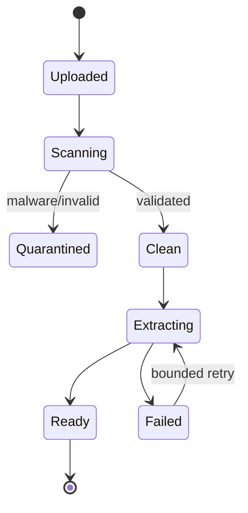

# Database, Documents, and Versioning

## Database authority

Before changing a model or migration, read:

- [Database schema V2.1](../docs/specs/RegBridge_DATABASE_SCHEMA_V2.1_RESEARCH.md)
- current SQLAlchemy models;
- every migration touching the same table;
- tests that assert constraints and authorization behavior.

Do not invent a table or column that is absent from the approved schema unless the current Jira ticket explicitly updates that source of truth.

## Migration rules

- Use Alembic for every schema change.
- Never edit a shared database manually as the implementation.
- Keep one coherent migration head unless deliberate branching is required.
- Test `alembic upgrade head` against a clean database.
- Run `alembic check` and investigate drift rather than hiding it.
- Include constraint/index naming and downgrade behavior where the project convention supports it.
- Never disable migration/security tests to make CI green.

The current migration chain contains the implemented domain evolution through contract-analysis updates. Confirm the actual head with:

```powershell
alembic heads
alembic current
```

## Main persistence groups

| Area | Representative tables |
| --- | --- |
| Identity | `users`, `user_identities`, `roles`, `user_roles`, `audit_logs` |
| Projects | `projects`, `project_facts`, `project_members`, startup profile/revision tables |
| Documents | `documents`, `document_versions`, `document_processing_jobs` |
| AI | `conversation_threads`, `conversation_messages`, `agent_runs` |
| Regulatory | assessment input snapshots, assessments, roadmap/item tables |
| Compliance | framework/version/control/adoption/project-control/evidence/link/score tables |
| Investment | investor/thesis versions, opportunities, matches, briefs, events, contact records |
| Research | profiles, outputs/versions, extraction/evidence, discoveries/versions, access, matches |
| Sharing | explicit resource grant records |
| Contracts | `contract_analyses`, `contract_clauses` |

Inspect models for exact names; this table intentionally summarizes families.

## Common versioning pattern

RegBridge preserves historical truth through immutable versions/snapshots:

```text
logical resource -> immutable version(s) -> selected/current pointer
                 -> derived run references exact version/snapshot
```

Used for documents, investor theses, opportunities, briefs, research outputs/discoveries, startup profiles, assessments, and other audited outputs.

Rules:

- Never overwrite an immutable version.
- Derived output records the exact input version/snapshot IDs.
- “Current” is a pointer or status, not permission to mutate history.
- Publishing/approval produces an explicit state/version transition.
- Unknown values remain unknown; do not backfill them from model inference.

## Document storage lifecycle



Exact state names can differ in code; preserve the implemented enum and transition checks.

### Upload invariants

- Supported content is validated from bytes, not just filename/MIME claim.
- The server computes SHA-256.
- Size limits come from Settings.
- Binary content is written to private object storage.
- Metadata and version state are transactional PostgreSQL data.
- A failed/quarantined object never becomes the current usable version.

### Extraction

Native extraction supports current PDF, DOCX, and UTF-8 text flows. OCR/external processing is feature-flagged. Jobs are persisted with bounded attempts, stale-job recovery, and explicit terminal states.

Do not make a production external service mandatory for ordinary automated tests.

## Contract analysis lifecycle

Contract Analysis V2 operates on one exact clean version:

```text
version authorization
-> extracted page-mapped text
-> section segmentation
-> bounded semantic section analysis when enabled
-> deterministic evidence verification
-> cross-section consistency
-> persisted analysis/findings
-> risk navigation and Contract Agent read view
```

Material findings require located text evidence. Provider failure or malformed output produces a partial result rather than invented risks. The original file is never modified.

## Project facts and knowledge graph

Project facts include status and provenance. Confirmed facts may feed authorized context and the derived graph. Pending conversational capture must remain reviewable and must not silently become trusted truth. Deletion/revocation must remove it from future trusted projections.

## Transaction and concurrency guidance

- Let services own transaction boundaries.
- Use database constraints for uniqueness/integrity, plus safe conflict handling.
- Make participation/registration operations idempotent where the domain specifies it.
- Avoid holding a transaction open while waiting on a slow provider/network call unless the existing service deliberately does so.
- Persist run/job state so interrupted processing can be diagnosed and safely retried.

## Database change checklist

- [ ] Jira explicitly requires the data change.
- [ ] Approved schema and decisions were inspected.
- [ ] Existing model and migration conventions are reused.
- [ ] Migration has upgrade/downgrade behavior.
- [ ] Clean-database upgrade passes.
- [ ] Model/migration metadata aligns.
- [ ] Positive, negative, and revoked-access tests pass.
- [ ] API contracts expose only intended fields.
- [ ] Audit behavior is tested for sensitive mutations.

